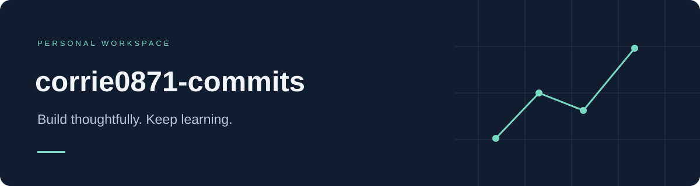

  

  <a href="https://github.com/corrie0871-commits?tab=repositories">Repositories · 项目</a>
  &nbsp; / &nbsp;
  <a href="https://github.com/corrie0871-commits?tab=stars">Stars · 收藏</a>

### Welcome / 你好

Welcome to my corner of GitHub.

这里是我的个人 GitHub 空间，记录探索与成长。

> Build thoughtfully. Keep learning.  
> 认真构建，持续学习。

---

corrie0871-commits · A little progress, one commit at a time.
